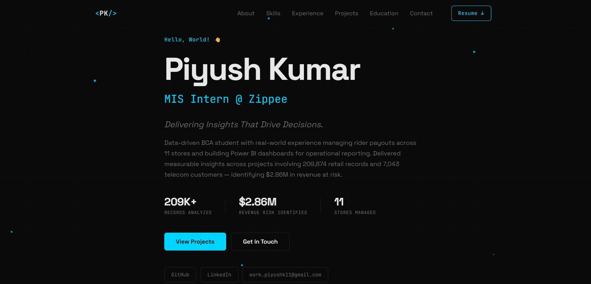

# Piyush Kumar — Portfolio Website

A dark, minimal personal portfolio built with React — showcasing my work as a Data Analyst with a focus on Business Intelligence and Data Science.

🔗 **Live Site:** [Add link here once deployed]



## About This Project

This is my personal portfolio, built to showcase my experience, projects, and skills as I work toward a career in Data Analytics and Data Science. It highlights my current role as an MIS Analyst at Zippee, real-world data projects involving large datasets, my technical skill set, and education background.

The site is built from scratch with a custom dark-themed design system — no UI frameworks — and includes an animated particle background, a typing-effect hero section, and a fully responsive layout that works across desktop, tablet, and mobile.

## Highlights

- **Real project case studies** — covers all the data projects I've built so far, including a 209,874-record retail dataset normalization and a telecom churn analysis that identified $2.86M in revenue at risk
- **Resume download** — visitors can download my resume directly from the site
- **Fully responsive design** — optimized for mobile, tablet, and desktop
- **Custom animated background** — canvas-based constellation particle effect
- **Interactive navigation** — smooth scroll, active-section highlighting, and a tabbed experience view

## Tech Stack

- **React 18** — component-based UI
- **CSS** — hand-crafted design system, no frameworks
- **HTML5 Canvas** — particle animation
- **Google Fonts** — Space Grotesk + JetBrains Mono

## Getting Started

```bash
git clone https://github.com/Piyush-K11/portfolio.git
cd portfolio
npm install
npm start
```

Runs locally at `http://localhost:3000`

## 📁 Project Structure

```
src/
├── App.js              ← All personal data (bio, skills, projects, experience)
├── App.css             ← Global layout & shared styles
├── index.js
├── index.css           ← Design tokens (colors, fonts)
└── components/
    ├── Navbar.js / .css
    ├── Hero.js / .css
    ├── About.js / .css
    ├── Skills.js / .css
    ├── Experience.js / .css
    ├── Projects.js / .css
    ├── Education.js / .css
    ├── Contact.js / .css
    └── Footer.js / .css
```

## Contact

- **Email:** work.piyushk11@gmail.com
- **LinkedIn:** [Piyush Kumar](https://linkedin.com/in/Piyush-Kumar)
- **GitHub:** [@Piyush-K11](https://github.com/Piyush-K11)

## License

This project is shared for portfolio and reference purposes. Feel free to explore the code, but please don't copy it directly for your own portfolio — use it as inspiration to build something that reflects your own work.